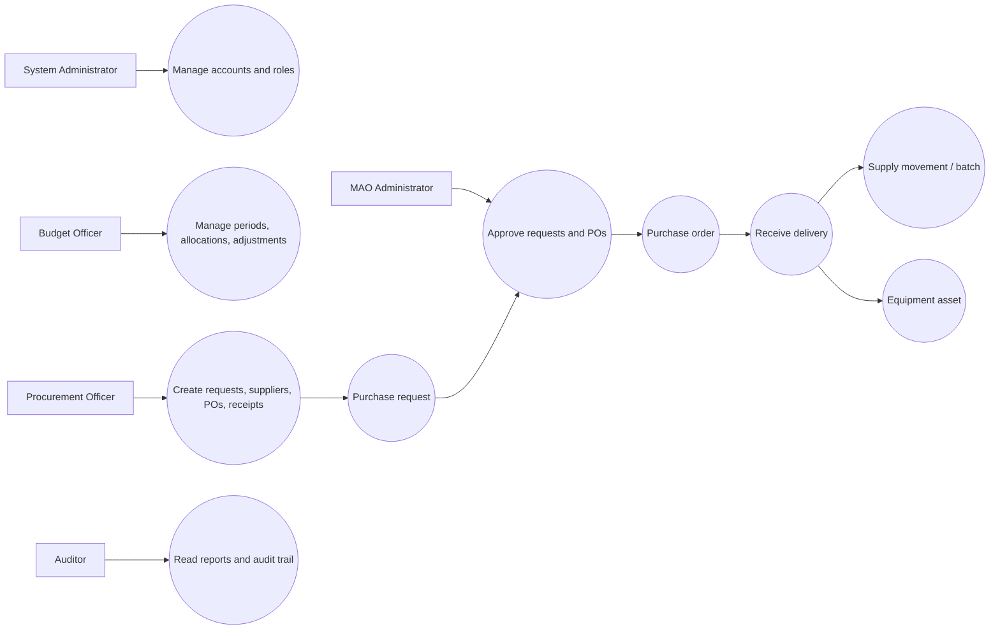
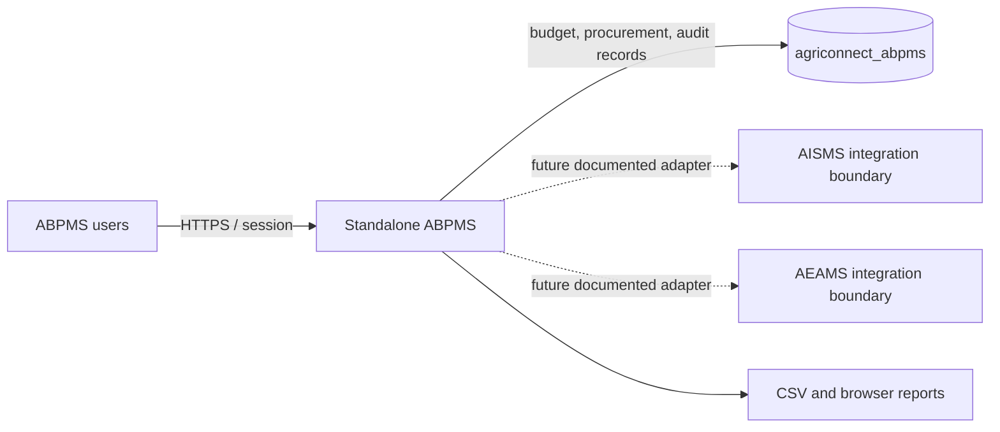
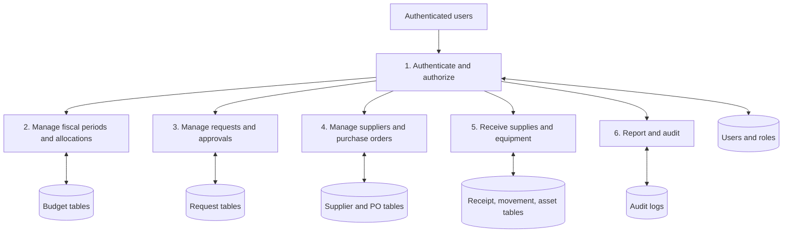
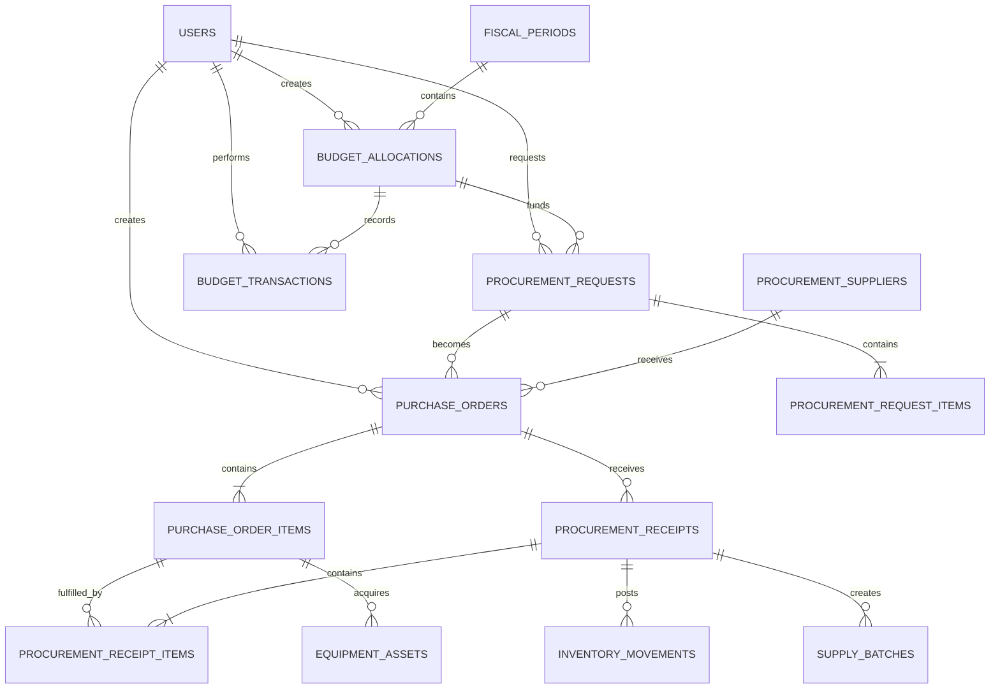
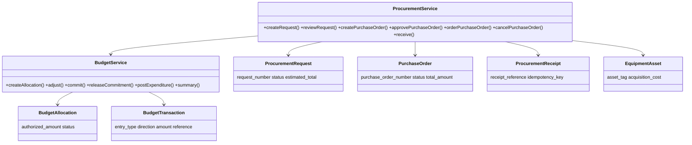
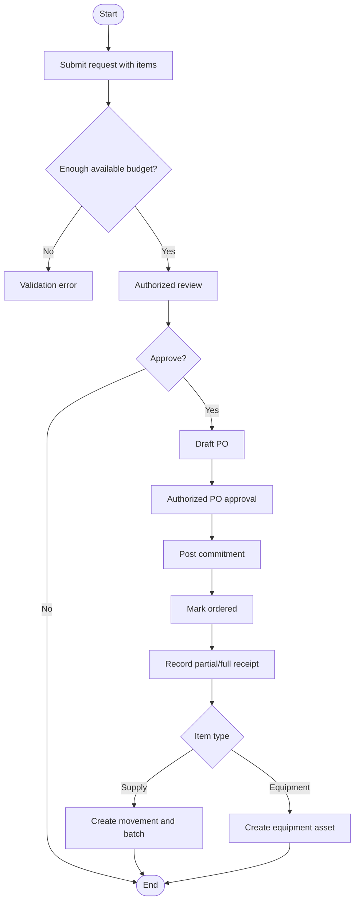
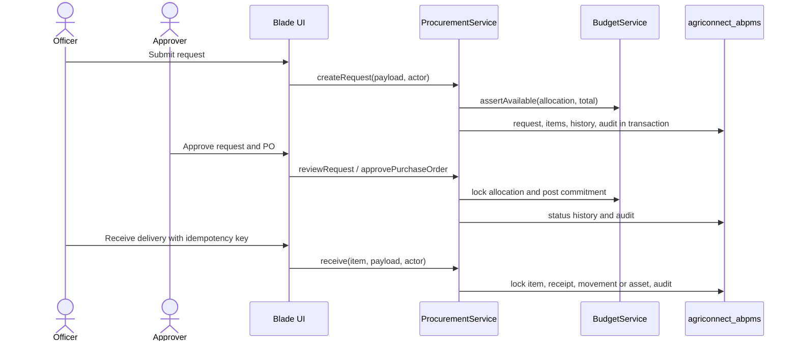

# Standalone ABPMS architecture

## System overview

ABPMS is an independent Laravel 13 application for the Bongabong Municipal Agriculture Office. It owns its users, session cookies, database connection, migrations, budget ledger, procurement workflow, internal supply receiving registry, equipment acquisition registry, reports, and audit log. It has no foreign keys or runtime reads against AgriConnect ERP, AISMS, or AEAMS.

The application is intentionally a focused ABPMS boundary. The `inventory_movements`/`supply_batches` tables preserve the supply-receipt behavior needed by procurement, while `equipment_assets` preserves acquisition behavior without pretending to be a full inventory or equipment-management suite. Those tables are the documented extension points for future API adapters.

## Scope and roles

| Role | Responsibilities |
| --- | --- |
| System Administrator | Accounts, roles, system-wide access, all operational views |
| MAO Administrator | Budget oversight and financial/procurement approvals |
| Budget Officer | Fiscal periods, allocations, adjustments, ledger, reports |
| Procurement Officer | Requests, suppliers, purchase orders, receiving |
| Auditor | Read-only reports and audit trail |

All write routes use authentication, active-account checks, role middleware, CSRF protection, server-side validation, and database transactions. A requester cannot approve their own request or related PO. Deactivation prevents login and invalidates an active session on the next request.

## Workflow rules

1. A fiscal period contains budget allocations. An allocation has an authorized amount and a ledger of debit/credit entries.
2. Available balance is `authorized amount + credits − debits`. Money is converted to integer cents in `BudgetService`; database columns remain `DECIMAL(14,2)`.
3. A procurement request calculates item totals and checks the allocation before submission. Approval rechecks the current balance.
4. A PO is created only from an approved request. PO approval creates one unique commitment reference. Cancellation releases the commitment.
5. Receiving locks the PO item, rejects quantities beyond the ordered balance, and requires a unique idempotency key. Supply receipts create exactly one stock movement and batch. Equipment receipts create an internal asset and no stock movement.
6. Status histories and `audit_logs` record material decisions, actors, references, timestamps, and relevant metadata.

## Database design

Core entities are `users`, `roles`, `fiscal_periods`, `budget_allocations`, `budget_transactions`, `procurement_suppliers`, `procurement_requests`, `procurement_request_items`, `purchase_orders`, `purchase_order_items`, `procurement_receipts`, `procurement_receipt_items`, `inventory_locations`, `inventory_movements`, `supply_batches`, `equipment_assets`, `procurement_status_histories`, and `audit_logs`.

The single standalone schema migration is ordered so MySQL foreign keys are added only after their parent tables exist. Composite indexes use short explicit names for MySQL identifier limits. The test environment uses an in-memory SQLite database; local runtime configuration uses MySQL database `agriconnect_abpms`.

## Security architecture

- Independent `APP_KEY`, session cookie, `.env`, database, and route namespace.
- Password hashing through Laravel's `hashed` cast / `Hash::make`.
- Login throttling and session regeneration.
- Active-account middleware on every authenticated route.
- Role middleware plus permission-aware navigation.
- CSRF protection on all state-changing web forms.
- Idempotency keys on requests, purchase orders, and receipts.
- Row locks and transactions around financial commitments and receiving.
- Append-only audit records for material actions.

## Installation

```powershell
cd C:\Agriconnect\abpms-system
composer install
Copy-Item .env.example .env
php artisan key:generate
# Create the independent MySQL database named agriconnect_abpms.
php artisan migrate --seed
npm install
npm run build
php artisan serve --host=127.0.0.1 --port=8001
```

Demonstration accounts are created only when a local `ABPMS_DEMO_PASSWORD` environment variable is set to a strong value. That variable is intentionally not committed. The seeded usernames are:

| Email | Role |
| --- | --- |
| `admin@abpms.local` | System Administrator |
| `mao@abpms.local` | MAO Administrator |
| `budget@abpms.local` | Budget Officer |
| `procurement@abpms.local` | Procurement Officer |
| `auditor@abpms.local` | Auditor |

## Capstone diagram sources

The following Mermaid sources are grounded in the implemented controllers, services, routes, and tables. They can be rendered in Mermaid Live, GitHub, or a documentation build.

### UML use case



### Context diagram



### DFD level 1



### ERD



### UML class diagram



### Activity diagram



### Sequence diagram


